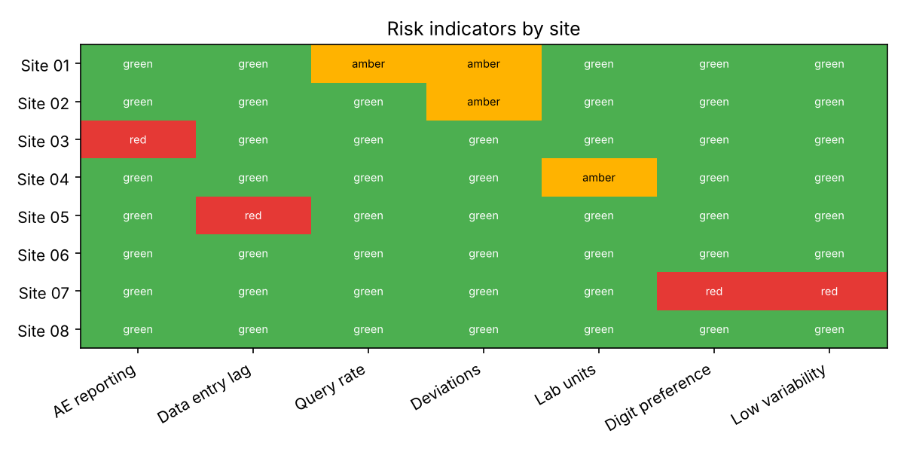

# Clinical trial data management: edit checks, SDTM, deviations, and risk-based monitoring

The data management workflow for a fictional phase 2 trial, from the raw EDC export to submission-format SDTM datasets: programmed edit checks that raise queries, data-driven protocol deviations, mapping to CDISC SDTM with conformance checks, key risk indicators and centralized statistical monitoring by site, and a database lock readiness summary.

The trial and its data are simulated (`src/simulate_edc.py`). Errors and site behaviors were injected on purpose and recorded, so each step is scored on whether it finds what is actually wrong, and on whether it raises queries on data that are fine.

**Study XYZ-201:** randomized, double-blind, placebo-controlled; 240 subjects at 8 sites; visits at screening, day 1, and weeks 2, 4, 8, and 12. Raw forms use CDASH-style variable names: DM, IE, SV, VS, LB, AE, EX, and DS.

## Results in brief

| Step | Result |
| --- | --- |
| Edit checks (11 programmed checks) | 56 queries. Every injected error was caught, with no queries raised on clean data: 14 implausible systolic pressures, 8 transposed systolic and diastolic values, 8 duplicate records, 4 AEs ending before they start, 10 lab results without units, and 1 visit dated before consent. The 6 diastolic range queries fall on the same transposed records, and 5 queries question serious AEs recorded as mild |
| Protocol deviations | All 34 out-of-window visits, 21 missed visits, 15 cases of dosing compliance below 80%, and the visit before consent were found. The 5 extra compliance deviations are real (natural low compliance, not injected). The 3 extra window deviations belong to the subject whose Day 1 was entered before consent, and they disappear once that date is corrected |
| SDTM | DM, SV, VS, LB, AE, EX, and DS as SAS transport (.xpt) and CSV, with a variable-level specification. Creatinine reported in µmol/L at one site is standardized to mg/dL |
| SDTM conformance | 11 rule types across all domains. The 46 failing records all trace to open queries: 10 unstandardizable lab results without units, 4 AE date errors, and 32 duplicated vital signs results |
| Site monitoring | Red flags fall exactly on the four planted site problems and nowhere else (see below) |

## Site risk



| Site | Signal | Evidence |
| --- | --- | --- |
| 03 | adverse event under-reporting | 0.12 AEs per subject-month against 0.38 elsewhere (rate ratio 0.31; Poisson p = 6.5 × 10⁻⁶) |
| 05 | slow data entry | median 16 days from visit to entry, four times the rest of the study |
| 07 | data too regular to be measured | every blood pressure ends in 0 (others: about 10%, as expected), and within-subject pulse varies with a standard deviation of 1.0 beat/min across visits against 5.5 elsewhere |
| 04 | non-standard lab unit (amber) | creatinine reported in µmol/L, which the SDTM mapping converts |

AE reporting compares each site's count with the rate at all other sites per month of exposure. Digit preference uses a chi-square test of terminal digits against a uniform distribution. Low variability compares each subject's spread across visits with subjects at other sites. Statistical tests are Bonferroni-corrected across the eight sites, and a site turns red only if the difference is also large enough to matter. The amber query and deviation rates at Sites 01 and 02 reflect ordinary variation and are flagged for watching, not action.

## SDTM mapping

`src/sdtm.py` follows SDTM Implementation Guide conventions:
- USUBJID built from STUDYID and SUBJID
- ISO 8601 dates
- study days relative to the first dose with no day 0
- --SEQ within subject
- VISITNUM and EPOCH
- original and standardized results with one standard unit per test
- normal range indicators for labs
- controlled terminology for test codes and AE severity

Every variable's label, origin, and derivation rule is in [`specs/sdtm_spec.csv`](specs/sdtm_spec.csv), written from the same metadata the code uses. Values are carried as collected: open queries are resolved at the source in the EDC system, not patched in the mapping. AEDECOD comes from a small illustrative dictionary in place of MedDRA, which is licensed.

## Repository layout

```
src/simulate_edc.py       simulated EDC export with injected errors (data/injected.json)
specs/edit_checks.csv     edit check catalog: rule, query text, severity
src/edit_checks.py        checks, query listing, scoring against injected errors
src/deviations.py         protocol deviation rules and scoring
src/sdtm.py               mapping to SDTM, .xpt and .csv output, specification
src/sdtm_checks.py        SDTM conformance rules
src/rbqm.py               key risk indicators, centralized statistical monitoring, site heatmap
src/run_all.py            runs the workflow and writes the lock readiness summary
specs/sdtm_spec.csv       variable-level SDTM specification
results/tables/           query listing, deviations, conformance, KRIs, lock readiness
results/sdtm/             SDTM datasets (.xpt and .csv)
tests/test_workflow.py    scores every step against the injected truth
```

## How to run

```
pip install -r requirements.txt
python src/run_all.py
python -m pytest -q tests
```

The workflow runs in a few seconds.

## Author

Patricia K. Kamanda. Released under the MIT License.
